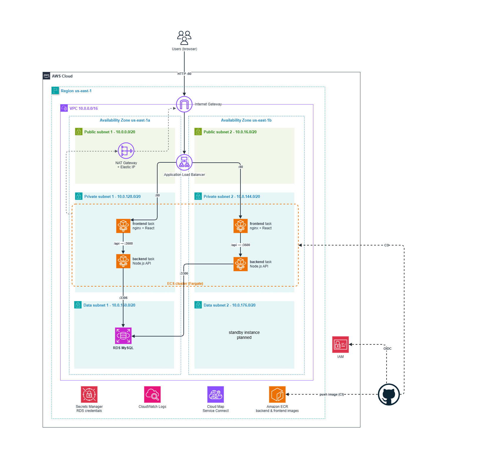

# Terraform AWS: Three-Tier App with ECS Fargate

Terraform code that deploys a three-tier application (React, Node.js, MySQL) on AWS: ECS Fargate behind an Application Load Balancer, a RDS MySQL database, and the IAM role used by GitHub Actions to build and deploy the images.

Application code and CI/CD workflows: **[marbrd/student-teacher-portal-3tier-app](https://github.com/marbrd/student-teacher-portal-3tier-app)**



## Usage

```bash
cd root
cp terraform.tfvars.example terraform.tfvars   # set db_username and github_repo

terraform init
terraform apply
```

Then, in the application repository, set the GitHub Actions variable `AWS_ROLE_ARN` to:

```bash
terraform output github_actions_role_arn
```

Run the **backend** workflow, then the **frontend** workflow, and open the app:

```bash
terraform output app_url
```

To delete everything:

```bash
terraform destroy
```